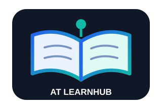
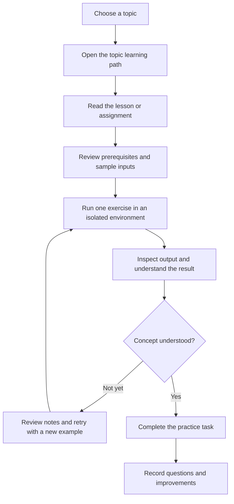
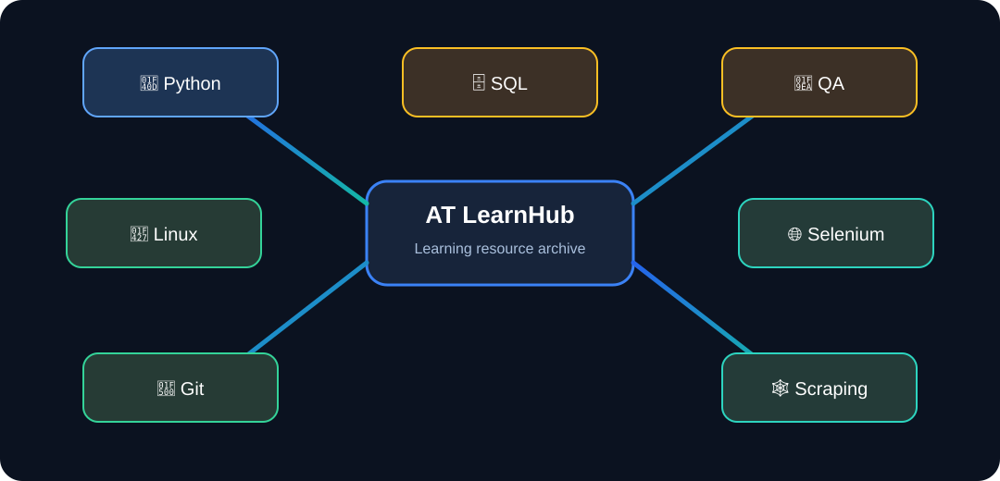

<div align="center">
  
  <h1>📚 AT LearnHub</h1>
  <p><strong>A structured learning archive for Python, Linux, Git, SQL, QA, Selenium, and web automation.</strong></p>
  <p>
    
    
    
    
    
    
  </p>
  <p><a href="#-start-learning">Start learning</a> · <a href="#-repository-catalog">Catalog</a> · <a href="docs/README.md">Documentation hub</a> · <a href="CONTRIBUTING.md">Contribute</a></p>
</div>

---

## 🧭 About AT LearnHub

**AT LearnHub** is a topic-organized learning archive. It brings together programming exercises, command-line practice, SQL course material, QA assignments, Selenium automation examples, datasets, transcripts, and reference documents.

This is not one deployable application. It is a collection of learning artifacts accumulated across topics and exercises. Different folders have different prerequisites, execution methods, and levels of completeness.

## 🎯 Start learning

Choose a topic based on what you want to practice:

| Learning track | What you will find | Start here |
|---|---|---|
| 🐍 Python | Syntax, variables, data types, operators, strings, collections, loops, functions, OOP and practice | [Python catalog](docs/learning-paths/python.md) |
| 🐧 Linux | Shell commands, file system concepts, scripts and command exercises | [Linux catalog](docs/learning-paths/linux.md) |
| 🔀 Git | Git notes and version-control practice | [Git catalog](docs/learning-paths/git.md) |
| 🗄️ SQL | SQL scripts, database examples, exercises and course documents | [SQL catalog](docs/learning-paths/sql.md) |
| 🧪 QA | Assignments, test documentation and quality practice | [QA catalog](docs/learning-paths/qa.md) |
| 🌐 Selenium | Browser automation exercises, assignments, test data and output files | [Selenium catalog](docs/learning-paths/selenium.md) |
| 🕸️ Web scraping | Python scraping exercises and browser-driven examples | [Scraping catalog](docs/learning-paths/web-scraping.md) |

## 🗂️ Repository catalog

| Directory | Purpose | Typical artifacts |
|---|---|---|
| `git/` | Git learning material | Notes and reference documents |
| `Linux/` | Linux command-line practice | ODT notes, text files, shell scripts, archives |
| `Python/` | Python training and exercises | `.py`, assignments, transcripts, media |
| `Python_Web_Scraping/` | Scraping and Python practice | Scripts and examples |
| `QA/` | Quality assurance learning | Assignments and supporting files |
| `Selenium/` | Browser automation | Python scripts, assignments, CSV/JSON, drivers |
| `sql/` | SQL learning | SQL scripts, course documents and examples |
| `docs/` | Repository documentation | Learning paths, guides, templates and diagrams |

The archive intentionally preserves course files and historical materials. Names, capitalization, spaces, and some legacy spelling in paths are kept as they exist. Use the catalog links instead of assuming paths can be renamed.

## 🧱 Learning workflow



## 🚀 Quick setup

### Python exercises

Use Python 3 and a virtual environment. From the repository root:

```bash
python -m venv .venv
```

Activate it:

```bash
# Windows PowerShell
.venv\Scripts\Activate.ps1

# Linux / macOS
source .venv/bin/activate
```

Run an individual script:

```bash
python "Python/Day-1/Python-1/Variables.py"
```

Not every exercise has the same dependencies. Check the local folder for a requirements file before installing anything.

### Linux examples

Use a Linux shell or a safe virtual machine/container. Read every command before execution. Some examples modify files or system state.

### SQL scripts

Use a disposable local MySQL-compatible database. Several scripts contain destructive statements such as `DROP DATABASE`. Never run them against production or personal databases. Read [SQL safety guidance](docs/sql-safety.md).

### Selenium exercises

Selenium examples may require a browser, matching browser driver, Python packages, external sites, and network access. Prefer local test pages. Do not run automation against real accounts or websites without permission. See [Selenium safety and setup](docs/selenium-guidelines.md).

## 🖼️ Visual overview

<p align="center"></p>

<p align="center"></p>

## 🧰 Repository structure

The repository is deliberately multi-topic. There is no single app entry point, build command, package lock, or deployment target.

See [Project structure](docs/project-structure.md) for a topic-level inventory and [Architecture](docs/architecture.md) for the relationship between source exercises, documents, datasets, and tools.

## 🛡️ Safe use and data handling

- Do not commit passwords, API tokens, browser profiles, cookies, private datasets, or personal information.
- Treat CSV/JSON input and output files as potentially sensitive until reviewed.
- Do not use bundled browser drivers blindly. Verify their origin, version, and integrity.
- SQL setup scripts can destroy databases. Use disposable schemas.
- Scraping and browser automation must respect permission, site terms, privacy, and rate limits.
- Review document, media, dataset, and model licenses before redistribution.

## 🧪 Validation

The repository is not a single testable application. Validation should be scoped to the changed artifact:

```bash
python -m py_compile path/to/example.py
bash -n path/to/script.sh
```

SQL scripts should be reviewed and tested on a disposable database. Selenium examples require permitted test targets and compatible browsers/drivers.

The repository includes a lightweight documentation and source validation workflow. A passing workflow does not imply every historical lesson or automation script is functionally correct.

## 🤝 Contributing

See [CONTRIBUTING.md](CONTRIBUTING.md). New material should be placed under the appropriate topic and include purpose, prerequisites, example input/output, and safety notes where needed.

## 📖 Documentation map

- [Documentation hub](docs/README.md)
- [Learning paths](docs/learning-paths/README.md)
- [Project structure](docs/project-structure.md)
- [Architecture](docs/architecture.md)
- [Installation](docs/installation.md)
- [Development guide](docs/development.md)
- [SQL safety](docs/sql-safety.md)
- [Selenium guidelines](docs/selenium-guidelines.md)
- [Data and licensing](docs/data-and-licensing.md)
- [Testing strategy](docs/testing-strategy.md)
- [Troubleshooting](docs/troubleshooting.md)
- [Glossary](docs/glossary.md)
- [Templates](docs/templates/README.md)
- [Diagrams](docs/diagrams/README.md)

## 📄 License

The repository includes an MIT license. See [LICENSE](LICENSE). Third-party documents, images, datasets, browser drivers, packages, and other bundled assets may have separate ownership or license terms. The repository license does not automatically relicense third-party materials.

<p align="center"><sub>AT LearnHub is an evolving learning archive. Always read the specific lesson and verify its prerequisites before running it.</sub></p>

Last updated: 2026-11-16 18:30 UTC
