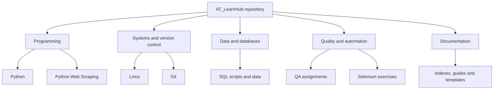

# 🏗️ Repository architecture

## Architectural model

AT_LearnHub is a **learning-resource repository**. It does not run as a unified service. Each directory is a separate learning track and may contain standalone scripts, assignments, reference documents, datasets, archives, media, or third-party tools.

The architecture is therefore organizational rather than a production runtime architecture.

## Resource classes

| Class | Examples | How to use |
|---|---|---|
| Runnable source | Python `.py`, shell `.sh`, SQL `.sql` | Inspect dependencies and execute in an isolated environment |
| Practice material | Assignments, exercises, test scripts | Read task instructions and preserve expected behavior |
| Reference documents | ODT, DOCX, ODS and notes | Open with a compatible office suite |
| Data files | CSV, JSON, text files | Inspect provenance, schema, and sensitivity before use |
| Media | MP4, transcripts | Use as learning context; confirm rights before redistribution |
| Tool binaries | Browser drivers, archives | Verify origin, version, and integrity before execution |
| Generated outputs | JSON results, transcripts, temporary files | Treat as derived artifacts; do not assume reproducibility |

## Top-level domains

## No global runtime

There is no shared Python package manifest, entry point, database service, API contract, deployment workflow, or common application configuration. Individual subprojects may have local requirements files, browser-specific assumptions, and their own input/output paths.

## Execution boundaries

- Run Python scripts one at a time and from their documented working directory.
- Run shell examples in a disposable Linux environment.
- Execute SQL only against a disposable database.
- Run Selenium only against permitted targets and test accounts.
- Open office documents and media as reference materials.
- Do not run opaque archives or binaries without inspection.

The original exercise and neighboring assignment materials define the intended lesson. The catalog documents navigation and safe execution, but does not replace the original material or claim every historical exercise is correct.
