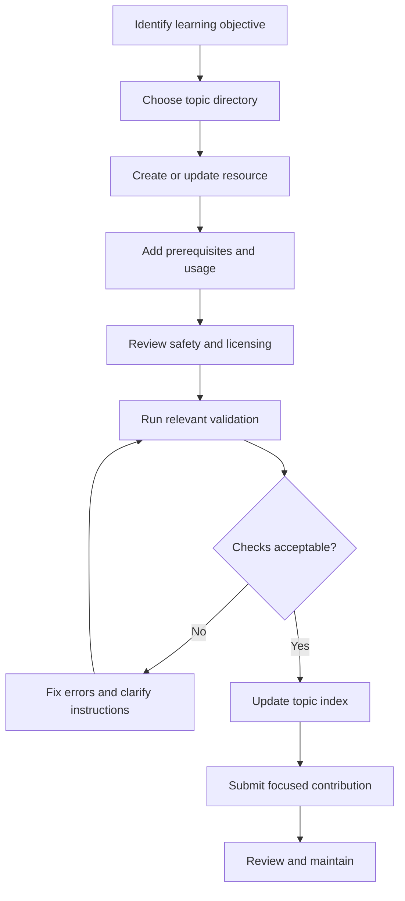

# 🔄 Learning resource lifecycle

## Resource lifecycle checklist
- Objective is explicit.
- Prerequisites are documented.
- Inputs and outputs are safe and understandable.
- License/provenance reviewed.
- Validation command is recorded.
- Learning path and index updated.
